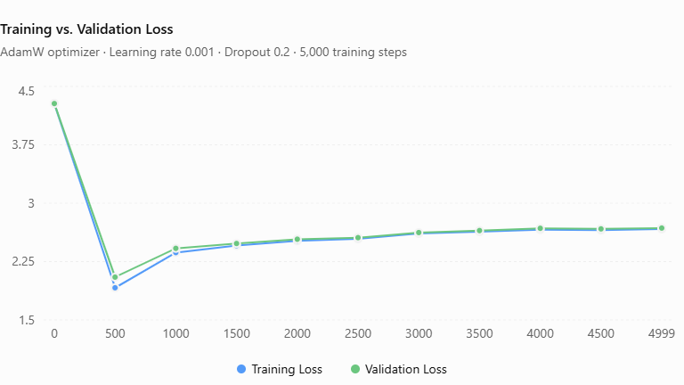
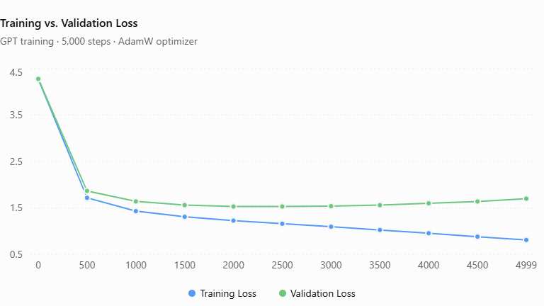
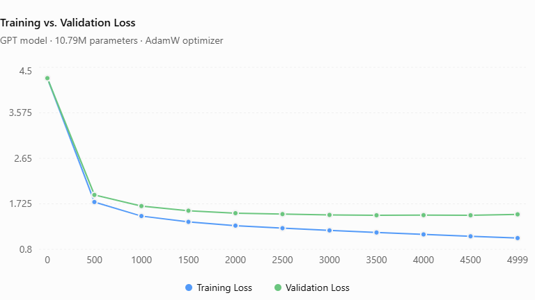
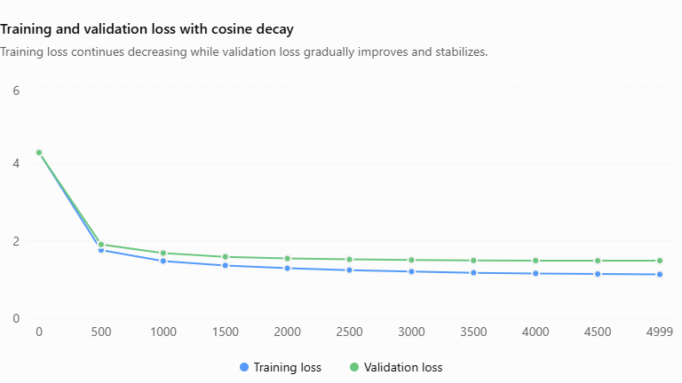

# nanoGPT
This repository holds the source code for a Generative Pre-trained Transformer (GPT), which is a language model built on the Transformer architecture. GPT is a state-of-the-art language model architecture hat delivers remarkable performance across a wide range of natural language processing tasks, such as understanding language and generating text. This project features a compact, scaled-down version of the GPT architecture containing around 10.8 million parameters, mirroring the structure of standard Large Language Models. While heavily inspired by Andrej Karpathy's educational GPT walkthrough, every line of code was implemented independently from scratch and trained iteratively on the Shakespeare dataset. Hyperparameters and custom optimizers were systematically tuned by monitoring training and validation losses to achieve optimal performance.

Some of the training results and adjustments are discussed below. 

# Phase 1:
AdamW Optimizer;
Learning Rate: 1e-3;
Dropout: 0.2

The graph indicates that the model initially learned effectively before performance gradually degraded, signaling that an excessively high learning rate caused the optimization to overshoot the gradient descent minima. To address this, both the learning rate and dropout rate were lowered for the subsequent training phase.

# Phase 2: 
AdamW Optimizer;
Learning Rate: 3e-4;
Dropout: 0.05

Although the second test successfully lowered the training loss, the validation loss continued to climb after an initial improvement, causing a widening gap between the two curves—a classic phenomenon of overfitting. To counter this, only the dropout rate was increased for the next phase to improve generalization.

# Phase 3: 
AdamW Optimizer;
Learning Rate: 3e-4;
Dropout: 0.15

During this phase, both training and validation losses successfully decreased to optimal levels, with validation loss only ticking up slightly in the final few iterations. This indicated that the learning rate and dropout were well-tuned, so a cosine learning rate scheduler was introduced for the final stage to smooth out the end-of-training anomaly and achieve even better results.

# Phase 4:
AdamW Optimizer;
Learning Rate: 3e-4;
Dropout: 0.15; a new optimizer "cosine learning rate scheduler" is added.

This phase delivered the best results among first 4, with both training and validation losses steadily plummeting throughout the entire training process until both reached optimal levels.
